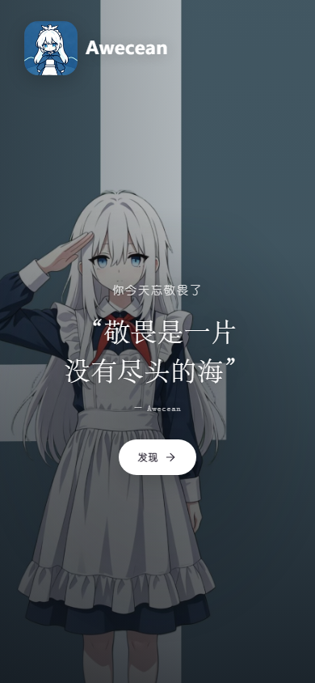
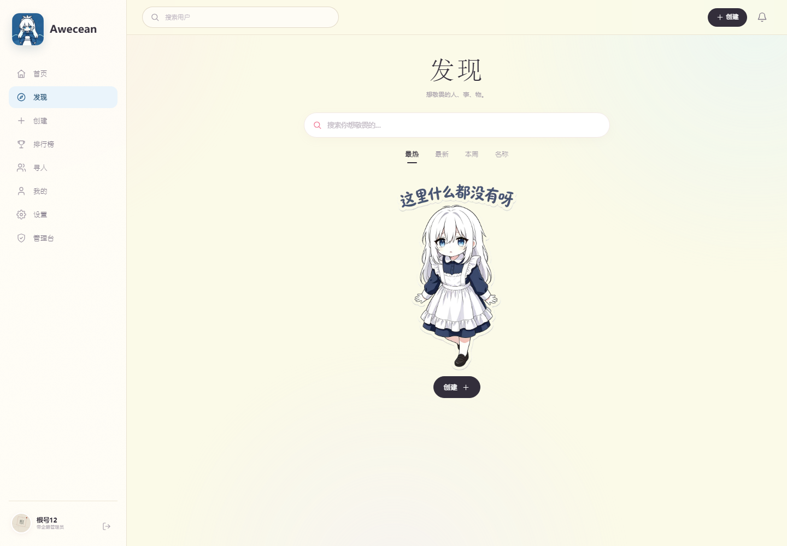
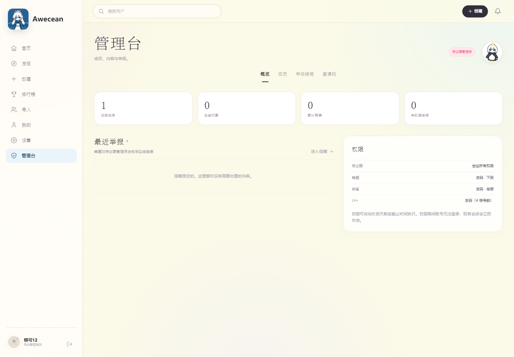

# Awecean

一个可以「敬畏某个人、某个形象或某个象征」的邀请制网站。
整体视觉偏 **极简、明亮、二次元 / 可爱**：奶油底色、雾蓝与柔粉、圆角卡片、圆体字，以及两位 Q 版站娘。

两种运行方式：

- **本地体验 / 开发**：Node.js 原生 HTTP + JSON 持久化，零数据库依赖。
- **正式部署**：Cloudflare Workers + D1 + R2，见 [README-CLOUDFLARE.md](README-CLOUDFLARE.md)。

## 预览

| 手机封面 | 桌面封面 |
|---|---|
|  |  |

| 桌面发现 | 桌面管理台 |
|---|---|
|  |  |

## 本地启动

```bash
node server.js
```

如果系统没有把 Node 加进 PATH，在 Windows 上也可以直接运行：

```powershell
.\start.ps1
```

打开 <http://127.0.0.1:4173>。默认端口可用 `PORT` 环境变量修改：

```powershell
$env:PORT=4174; node server.js
```

运行环境：Node.js 18+。首次启动会自动生成 `data/db.json`。

> 初始化只写入一个站长账号和一枚邀请码，站点内容为空。站长账号与邀请码不写入页面，请由部署者自行保管。

## 已实现

- 邀请制注册：邀请码一次性、48 小时自动删除；管理员 / L4+ 可发码，按角色扣除根号数。
- 账号：密码登录、会话鉴权、头像上传（温和压缩）、签名、邮箱、邀请人、用户名实时唯一性校验、改名扣 5 根号数。
- 权限：帝企鹅（站长）、鹈鹕、麻雀、L4+、普通成员；角色升降、按天数或截止时间封禁、下架、举报信箱。
- 敬畏对象：主图、次要图横向滑动与灯箱、简介、必填名言、纯文字模式、公开/私有两种编辑权限。
- 敬畏行为：每对象每天一次，每日可敬畏人数 = 等级；每次 +1 根号数；5 天少于 5 次自动下架。
- 等级与记录：L1–L5、连续敬畏、累计敬畏、连续未敬畏、敬畏日历、记录公开/私密开关。
- 榜单：同等级组内最勤奋榜、最受敬畏形象 Top 10、按历史最长连续未敬畏天数排序的忘敬畏榜。
- 搜索：用户 / 对象搜索与多排序；关注、粉丝与个人主页。
- 封面：手机端全屏插画；桌面端左文右图分栏。今天尚未敬畏时显示「你今天忘敬畏了」，已敬畏时显示「今天，你已敬畏」；封面轮播名人名言，点击可换一句；其他页面不再放装饰性名言，对象详情只保留对象自己的句子。只保留「发现」一个按钮。
- 首页 = 封面：点击「首页」回到封面；登录后直接进入「发现」。
- 桌面端：232px 固定左侧栏 + 顶部搜索 + 1200px 主内容区；发现页卡片 3 列（1440px 以上 4 列）。
- 移动端：顶栏 + 5 格底部 dock（首页 / 发现 / 创建 / 排行 / 我的），图片懒加载、客户端压缩、紧凑卡片与大量留白。
- 权限：站长账号的角色写在用户数据里，不依赖用户名；改名后仍然是帝企鹅。
- 视觉：奶油底、雾蓝、柔粉；新版 Awecean 图标、两只 Q 版站娘与「这里什么都没有呀」空状态贴纸。
- 站点名只使用英文 **Awecean**，界面不再显示中文站名。

## 项目结构

- `public/`：静态 SPA（无需构建）。
- `server.js`：本地 Node.js 服务，JSON + 本地图片。
- `worker.mjs`：Cloudflare Worker API，D1 + R2。
- `schema.sql` / `wrangler.toml`：Cloudflare 表结构与绑定。
- `README-CLOUDFLARE.md`：GitHub → Cloudflare 部署步骤。

## 数据与文件

- 本地：`data/db.json` + `public/uploads/`。
- Cloudflare：D1 `site_state` + R2 `BUCKET`。
- 本地密码使用 `scrypt` + 随机盐；Worker 使用 PBKDF2-SHA256（50,000 次）。两套数据独立。
- 会话 Cookie 均为 HttpOnly、SameSite=Lax。
- 备份本地时复制 `data/db.json` 与 `public/uploads/` 即可。

## 测试

本次初始化为空站点，不再附带会写入大量测试账号的自动化测试数据。开发验收覆盖了封面名言切换、登录后进入发现、桌面侧栏、移动 dock、空状态、站长改名后权限不变等流程。

## 部署到 Cloudflare

完整步骤见 [README-CLOUDFLARE.md](README-CLOUDFLARE.md)。最短路径：

```bash
npm install
npx wrangler login
npx wrangler d1 create awecean
npx wrangler r2 bucket create awecean-uploads
# 把 d1 create 返回的 id 写入 wrangler.toml
npx wrangler d1 execute awecean --remote --file=./schema.sql
npm run cf:deploy
```

也提供了 `.github/workflows/deploy.yml`，把仓库推到 GitHub 后配置 `CLOUDFLARE_API_TOKEN` 与 `CLOUDFLARE_ACCOUNT_ID` 即可自动部署。

## 约定与取舍

- **私有 = 编辑权限**：私有对象仍然可见，但只有创建者能修改；公开对象任何成员都可编辑内容，只有创建者能收回私有。
- **忘敬畏榜取「历史最长连续未敬畏天数」**：当前连续天数会在个人页展示。统计从第一次敬畏之后开始，避免新账号因注册前几天被误判。
- **普通管理员**：需求文档中「普通管理员」与三级管理员存在重叠。本实现将发码 + 举报交给麻雀，将下架权交给鹈鹕 / 帝企鹅，以保留举报升级链路。
- **邀请码成本**：帝企鹅 / 鹈鹕免费；麻雀 2 个根号数；L4+ 4 个根号数。
- 初始化数据只有站长一个账号、一枚邀请码和空内容；页面、文案与插画均为本地静态资源，不依赖外部字体或图片服务。
- Cloudflare 上如果已经写入过旧状态，需要先执行 `DELETE FROM site_state;` 再刷新 API，让 Worker 以新的单站长城主状态重新播种。
